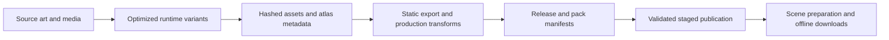

# Dune Relay asset loading and offline play

**Status:** Future feature draft  
**Date:** November 19, 2026  
**Scope:** Asset preparation, loading recovery, chapter downloads, offline play, and release updates.

## Purpose

Make the game reliable on slow mobile connections and playable offline after an explicit download. One asset manifest should support scene preparation, chapter prefetching, and offline downloads. The awning should conceal a short scene handoff, rather than an entire network transfer.

This is a proposal, not implemented offline support. Cloud saves, Portal authentication, and gameplay difficulty changes are outside this feature.

## Current behavior and evidence

Dune Relay uses Next.js static export, TypeScript, and Phaser beneath `/dune-relay/` on the shared Portal Artifacts origin. Campaign saves and coins are local. Playtest state and its wallet are separate. Music is synthesized locally through Web Audio.

The November 19 diagnostic exports contain two distinct map-readiness timeouts at the current ten-second foreground limit. Both subsequently logged transition completion. Neither captured window records a renderer crash or an asset-specific error. Slow downloading is plausible, but these logs cannot distinguish downloading, decoding, or initialization. Separate fullscreen request timeouts require a separate investigation.

Currently the curtain closes before loading, and recovery offers Reload game. There is no verified offline download system. Caddy applies `Cache-Control: no-cache` to the game: files may be stored, but normal reuse requires validation. This differs from `no-store`. [MDN Cache-Control](https://developer.mozilla.org/en-US/docs/Web/HTTP/Reference/Headers/Cache-Control)

The public asset directory is approximately 40 MiB, including 26 MiB of sprites and 11 MiB of cinematics. These directory measurements include potentially unused assets; they are not an audited runtime transfer size or an optimized offline budget.

## Player loading flow

Keep the existing scene visible while the destination downloads. Show destination, loading stage, real progress, and Cancel. Use byte progress when known; otherwise use completed files and an indeterminate indicator. Separate downloading from graphics preparation. Do not invent percentages for decoding.

After required files are available:

1. Close the awning.
2. Destroy the old Phaser scene through the serialized lifecycle.
3. Prepare the destination scene.
4. Open the awning after readiness confirmation.

Do not overlap decoded Phaser scenes. If preparation fails, expose Retry and Return to story. If story assets are unavailable, use a lightweight recovery screen. Preserve the current mobile backing-pixel cap of approximately two million pixels and explicit GPU resource release.

Replace the fixed transfer deadline with progress-aware stall detection. A proposed initial threshold is 30 seconds without foreground transfer progress; healthy slow transfers may take longer overall. Decoding and scene initialization need separate watchdogs. Hidden tabs must not trigger false stalls.

## Asset pipeline

Keep source artwork and provenance separate from runtime outputs. Publish only required runtime assets. Generate image dimensions and formats reproducibly. Compare high-density displays, transparent edges, thin outlines, and small tile silhouettes before accepting optimization. Resized sprite sheets must have matching frame metadata; sheet dimensions and frame constants cannot drift independently.

Generate dependency closure from an explicit asset registry, chapter declarations, and build outputs. Include lazy JavaScript chunks, CSS assets, fonts, posters, recovery UI, and atlas metadata. Regex-only discovery is insufficient.

| Manifest field | Purpose |
| --- | --- |
| Release ID | Pins compatible executable and assets |
| Rules and content versions | Records level and gameplay compatibility |
| Pack ID and dependencies | Defines core, chapter, and cinematic closure |
| Asset ID, URL, type | Stable loading and diagnostics lookup |
| Byte size and checksum | Progress and complete-file verification |
| Variant and atlas references | Preserves rendering compatibility |

Use content-hashed URLs for immutable assets. Keep HTML, release discovery, and the service worker revalidatable. Generate manifests after bundle names are known; avoid self-referential manifest checksums.

Production injects Plausible and the shared artifact-links script after static export. Shell checksums must describe final served HTML after this transformation, or a deliberately specified canonical transform. Analytics and artifact links must be optional offline. Validate production HTML and headers, not only the local Next output.

Extend existing staged artifact publication: validate the candidate release before promoting it. Preserve source masters outside the deployed runtime pack.

## Loading coordinator and financial safety

A preparation coordinator owns each load generation, dependencies, progress, cancellation, and readiness. States are checking cache, downloading, validating, preparing scene, ready, cancelled, and failed.

Every retry gets a new generation. Late callbacks, timers, and completed requests from cancelled or failed generations cannot take over the screen. Abort supported operations and discard late results from operations that cannot stop immediately.

Purchased starting boosters are debited exactly once, only after the intended board is ready and that attempt remains authorized. Cancellation, timeout, and failed preparation must not charge through late callbacks. Persist earned rewards before the winning reveal; retry, refresh, and animation skip cannot duplicate them.

Prefetch compressed bytes rather than decoding whole chapters into GPU memory. Bound download concurrency and checksum work; avoid multiple full in-memory copies of large files. Preserve renderer destruction before video decoding and release movie sources before creating the next scene.

## Offline download experience

Settings gains **Download for offline play**. Show actual size and remaining bytes for each pack.

| State | Action |
| --- | --- |
| Not downloaded | Download |
| Downloading | Cancel |
| Interrupted or incomplete | Resume or Retry |
| Ready offline | Remove download |
| Update available | Download update |

The first download requires a connection. PWA installation is optional; supported normal browser tabs should also reopen offline. Asset availability never unlocks story progression.

Use three pack types:

- **Core:** Shell, executable dependencies, fonts, recovery UI, and shared gameplay assets.
- **Chapter:** Backgrounds, characters, tile variants, and chapter story dependencies.
- **Cinematics:** Optional complete movies and metadata.

Only mark a pack ready after every required file and dependency is verified. Reuse already verified complete files after interruption; byte-range download resumption may follow later. Check required cache entries when opening a chapter because browser eviction can invalidate an earlier ready state. `navigator.onLine` is a hint, not proof of connectivity or offline readiness.

## Service worker boundaries

Register only within `/dune-relay/`, on HTTPS production or localhost development. Audit existing registrations on the shared origin before rollout. Service workers can serve cached responses offline. [MDN service workers](https://developer.mozilla.org/en-US/docs/Web/API/Service_Worker_API/Using_Service_Workers)

Use a same-origin public GET allowlist and game-owned cache namespace. Never cache authentication, personalized APIs, analytics, or unrelated artifacts. Never clear origin-wide caches or localStorage.

Approved navigation parameters such as `playtest` and `cabu` may resolve to the same cached shell while retaining runtime behavior. Do not globally ignore version queries on assets. Never return HTML as a fallback for failed JavaScript, images, media, or APIs.

Missing optional movies show a poster and explicit Skip or Continue, preserving the durable chapter checkpoint. A partial HTTP 206 response cannot count as a downloaded movie. Offline media requires complete cached files and tested 206/416 byte-range handling. Until verified, keep movies network-only with poster fallback. Do not broaden worker scope to cache shared root scripts.

## Safe updates and storage

Pin each active session to a compatible release. Stage and verify a candidate while retaining the old complete release. Activate only at a safe story or idle boundary, not during a level, purchase, or cinematic.

Do not automatically force `skipWaiting` or client takeover into a running game. Track multiple tabs; retain versions still needed by active clients. A failed or quota-limited update must leave the previous downloaded release usable. Explain insufficient staging space rather than deleting working content first.

Storage estimates and persistence requests are best effort. Browser quotas and eviction vary, and storage is shared at the origin level. Downloads are not permanent backups. [MDN storage quotas and eviction](https://developer.mozilla.org/en-US/docs/Web/API/Storage_API/Storage_quotas_and_eviction_criteria)

Removing packs preserves campaign saves, playtest wallet and archives, and audio settings. Detect eviction and offer repair when connected. If service workers or storage are unavailable, ordinary online play remains usable with an explanation that offline downloads are unavailable.

## Saves and future Portal integration

Initial offline play supports existing guest progress on the device. Login and future synchronization need a connection. Keep tokens and personalized responses outside asset caches.

Cloud conflict resolution and authoritative coin accounting require a separate specification before account synchronization launches. Define operation identifiers and duplicate prevention; do not merge two device balances by simple addition. Offline support does not imply these systems already exist.

## Diagnostics and rollout

Extend bounded local exports with release, pack, generation, asset ID, cache result, loaded/expected bytes, last progress time, foreground elapsed time, failed stage, and recovery outcome. Exclude credentials, sensitive URL parameters, and unbounded frame logs. A remote analytics service is not required.

Report real build pack sizes and establish budgets after dependency and visual audits. Do not promise an optimized total in advance.

Deliver in four independently useful phases:

1. Asset audit, runtime optimization, manifests, hashed URLs, and headers.
2. Visible loading, cancellation, retries, generation guards, and diagnostics.
3. Verified core/chapter offline downloads, storage management, and safe updates.
4. Tested optional offline cinematics and optional PWA installation.

## Acceptance matrix

The following are proposed targets, not measured guarantees. Test a custom slow profile of 50 KB/s download and 400 ms latency. Cancellation should respond within 500 ms. Retain current rendering and lifecycle safeguards.

| Scenario | Required outcome |
| --- | --- |
| Slow first load | Visible progress; no ten-second failure solely due to an active transfer |
| Disconnect during download | Pack stays incomplete; retry reuses verified files |
| Cancel then late readiness | No scene takeover, stale event, or booster debit |
| Decode or scene failure | Recovery appears and resources are released |
| Hidden tab | No false foreground stall or duplicate retry |
| Offline reload, complete packs | Gameplay opens without mandatory network dependencies |
| Missing chapter/movie | Download guidance or poster fallback; no trapped curtain |
| Quota failure/eviction | Old usable release retained; missing content detected |
| Update with two tabs | Compatible code and atlases in both sessions |
| Win then refresh/skip | Reward persists exactly once |
| Campaign and playtest | Wallets and saves stay isolated |
| Pixel 9 Chrome and desktop | Responsive controls, sharp artwork, acceptable memory |
| Production deployment | Transformed HTML, subpath URLs, and headers verified |

## Open decisions

Choose image formats and dimensions after visual QA; set transfer concurrency after mobile memory tests. Decide retained release count and default download selection. Suggested default is core plus current chapter, additional chapters explicit, and cinematics optional.

## Implementation references

- [Scene transitions and purchase authorization](../src/game/GameShell.tsx)
- [Phaser loading](../src/game/GameCanvas.tsx)
- [Renderer lifecycle](../src/game/gameLifecycle.ts)
- [Save handling](../src/game/save.ts)
- [Diagnostics](../src/game/diagnostics.ts)
- [Static export configuration](../next.config.ts)
- [Artifact publication](../scripts/build-artifact.mjs)
- [Production headers](../../../Caddyfile)
