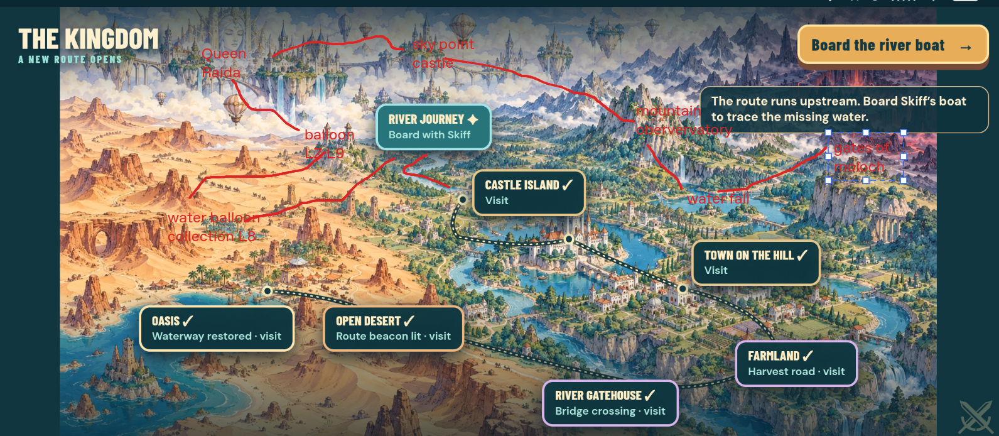

# Dune Relay lore and campaign direction

**Status:** Flexible starting point for future development

**Updated:** November 25, 2026

## Purpose and working agreement

Use this as a shared reference for the kingdom journey, story, party, and introduction of mechanics. The broad direction was agreed in conversation; chapter names, characters, powers, obstacles, and level counts remain open to revision through writing and playtesting. This is not an implementation checklist or a commitment to build every proposed mechanic.

The route contains sixteen chapters, including two in the sky. Ten levels per chapter would mean 160 total levels, or 90 beyond the current seventy authored levels. That is a planning scale, not a production promise. The demo teaser promises new adventures without a fixed level count.

## Story foundation

The kingdom's water, trade, and communication systems have stopped working together. The party begins by repairing one pump. Each repair reveals a neighboring community's problem and makes the next journey possible.

Over time, the party discovers that communities have protected their own supplies and infrastructure in ways that leave everyone worse off. The larger journey is about restoring cooperation as well as machinery. Moloch gives that failure a visible form and becomes the final confrontation.

Early chapters should feel like tangible local adventures. Introduce the larger explanation gradually through broken shipments, conflicting reports, isolated mechanisms, and people the player meets. Express Guild ideas through characters and consequences rather than lengthy explanations of organizational practices.

## Field guide grounding and game adaptation

The Field Guide uses **Queen Raida** as its spelling. She is a scout and scribe who gathers context and helps people understand what is happening; people retain judgment and make decisions. **Moloch** represents coordination failure: individually reasonable incentives can produce an outcome nobody wanted.

The guide's classes provide useful foundations for new companions:

- **Druid:** data, patterns, and evidence. A farm character can track growing seasons, water levels, and harvest yields.
- **Bard:** communication and helping useful stories reach people.
- **Artificer:** automation, tools, and dependable recurring systems.
- **Necromancer:** restoring and operating systems; a natural fit for aging mountain infrastructure.

These are established class concepts. The specific people, dialogue, powers, and adventure in this document are proposed game adaptations. The kingdom geography is an illustrated metaphor in the guide, not a statement of actual Guild departments, ranks, or policies.

Sources:

- [Published Field Guide](https://portal-artifacts-production.up.railway.app/raidguild-field-guide/)
- [Local kingdom lore and annotations](../../raidguild-field-guide/content/kingdom.mjs)
- [Local class profiles and lore](../../raidguild-field-guide/content-studies.json)
- [Kingdom artwork provenance](../../raidguild-field-guide/art/kingdom-source.md)

## Annotated kingdom route — November 25, 2026

This supplied markup is the geographic reference for future chapter locations and travel paths. It refines the flexible route below; it does not unlock or implement the future chapters.

- **7 · River Journey:** leave Castle Island and follow the river upstream. The kingdom map must visibly connect the castle's river anchor to the River Journey anchor, rather than ending the path below its chapter label.
- **8 · Water-balloon collection station:** the second oasis in the desert, above the first Oasis and west of the river. Follow the marked return toward the desert to investigate water collection.
- **9 · Balloon landing zone:** the hill with two towers above the collection station. The balloons take the party onward into the sky.
- **10 · Queen Raida:** the left-hand sky-castle region.
- **11 · Sky Point Castle:** the next sky-castle region to the right, joined by the marked sky route. This is the second sky chapter's working location/name.
- **12 · Mountain Observatory:** the mountain settlement to the upper right, reached after the sky chapters. This refines the earlier Mountain Villa and Balloon Landing working name.
- **13 · Waterfall:** descend from the observatory to the waterfall immediately below it.
- **14 · Gates of Moloch:** continue east from the waterfall to the marked volcanic gateway; Lava Pool and the Moloch finale follow the existing plan.

Keep these names and routes open to story development. Chapter labels should point clearly at their illustrated landmark, and travel paths should join the actual landmark anchors even when labels need an offset for readability.

## Campaign route and progression

Chapters 1–7 describe the current playable direction. Chapters 8–16 are proposals. Destinations follow the agreed route; mechanics are candidates rather than a requirement to add a new rule at every stop.

| Chapter | Destination | Story and reason to continue | Gameplay direction |
| --- | --- | --- | --- |
| 1 | Oasis | Restore the pump and discover that the supply route has gone quiet. | Existing introduction to Jets, Flywheels, Prisms, and combinations. |
| 2 | Open Desert | Get the desert walker caravan moving toward the river. | Existing fourth matching symbol and salt crust. |
| 3 | River Gatehouse | Raise the gate and open the bridge into farmland. This is the river crossing, not the coastal fort. | Existing fifth symbol, stronger crust, and shaped boards. |
| 4 | Farmland | Water has returned, but stored seeds and neglected channels need attention before the farms recover. Meet a Druid-inspired companion. | Falling, multi-hit armored seedpods; retain five symbols. |
| 5 | Town on the Hill | Deliver the harvest and help neighborhoods coordinate supplies and information. Meet a birdlike Bard town crier. | Falling delivery crates; every bottom edge of the playable board is an exit. Use five matching symbols initially, with four in levels 5.8–5.10 after difficulty tuning. |
| 6 | Castle Island | Discover that reservoir records and actual deliveries disagree; meet a beetle quartermaster and organize an upstream investigation. | Introduce active raid-member selection; combine familiar mechanics, retain five symbols, and add no new obstacle. |
| 7 | River Journey | Follow the missing water upstream aboard a repair boat. | Clearly marked currents that shift pieces after a turn. |
| 8 | Second Oasis and Water Collection Station | Repair the collection balloons and discover why shipments stopped. Meet an Artificer-inspired companion. | Sixth symbol, with a balloon-themed power introduced later if useful. |
| 9 | Balloon Landing Zone | Ride to the twin towers and prepare an ascent into the clouds. | Develop balloon powers, delivery goals, and currents without another symbol. |
| 10 | Sky Castles Arrival | Reach Raida and reconnect scattered reports from across the kingdom. | Relay objectives: activate a set of connected mechanisms. |
| 11 | Sky Point Castle (second sky chapter) | Raida assembles the evidence. The party chooses to investigate the mountain infrastructure. | A sky-region climax combining learned mechanics. |
| 12 | Mountain Observatory and Balloon Landing | Land at an isolated maintenance station and meet a Necromancer-inspired restorer. | Seventh and final symbol, if playtesting supports it; simplify other demands during introduction. |
| 13 | Waterfall | Restore the great cascade and open the route toward the volcanic frontier. | Candidate frozen tile shells, or a chapter focused on vertical drops and transport. |
| 14 | Gates of Moloch | Reconnect defenses that have become isolated and obstructive. | Staged locks and coordinated objectives using established mechanics. |
| 15 | Lava Pool | Build a crossing through machinery that drains neighboring systems to keep itself running. | Candidate lava spread with visible warnings, bounded growth, and a clear prevention action. |
| 16 | Moloch | Break the mechanism that keeps the kingdom working against itself. | A multi-phase finale built from learned mechanics and party contributions. |

Chapter 5 has an authored ten-level implementation. Its rules, access gate, level sequence, and test priorities are in the [Chapter 5 implementation spec](CHAPTER_5_TOWN_SPEC.md). Castle Island is implemented as Chapter 6; see the [Chapter 6 implementation spec](CHAPTER_6_CASTLE_SPEC.md). River Journey is implemented as Chapter 7; see the [Chapter 7 implementation spec](CHAPTER_7_RIVER_SPEC.md).

The river investigation leads to the second oasis because it houses water-collection balloons. Repairing them supplies transportation to the balloon landing zone and then the sky. This makes the return toward the desert a consequence of the investigation.

## Farmland starting concept

Farmland is a free Portal login bonus after the thirty-level demo ends at the River Gatehouse. The player explicitly claims a separate server-side account grant after finishing the demo. The grant stays recorded even if future access rules change. Its ten levels are now playable; see [Chapter 4 implementation spec](CHAPTER_4_FARMLAND_SPEC.md) for the current rules.

The next chapter should add a companion and a distinct obstacle without expanding the matching pool immediately.

**Armored seedpods** are the proposed coconut equivalent: tough seed husks with bronze bindings that crack visibly before opening. A possible introduction is:

> The water's back. But these seeds were sealed away through the drought. We need to open the stores and get the planting channels running before the next caravan leaves.

Initial rules to prototype:

- A pod occupies a cell and falls with gravity.
- It is an obstacle, not a sixth matching color.
- Two damaging events crack and open it; opening advances the harvest goal.
- Ordinary adjacent matches damage it.
- Jets and Flywheels require direct hits, consistent with salt.
- Teach pods alone before combining moving pods with stationary salt.
- Use finite, authored spawning so completion does not depend on an endless random supply.

The clearest first version falls but cannot be manually swapped. Swappability, Prism interactions, and whether overlapping effects count as separate hits remain design decisions before implementation. No existing salt behavior should change implicitly because a new obstacle is added.

The Fieldkeeper, a stocky leafy farmer of the guide's Druid species, reads harvest and water patterns and finds that the farms' problem began upstream. His story contribution matters beyond granting a power-up.

The Field Guide's character range includes nonhuman creatures. Keep that variety as a design principle for future companions and local characters instead of defaulting the whole party to humans. Ground each new character in the guide's class identity, local work, and chapter story while allowing a distinct personality and silhouette.

## Chapter 5: Town on the Hill

**Working direction updated November 21, 2026.** The ten-level implementation is available for review; these notes retain the broader story direction. See the Chapter 5 implementation spec for authored rules and level budgets.

### Story and companion

The party brings the Farmland harvest convoy into the hill town, but the market is jammed. Neighborhoods have conflicting delivery instructions, supplies are piling up, and everyone thinks someone else is handling the distribution. Helping the town move its supplies introduces the kingdom's coordination problem through a practical local adventure.

A Bard-inspired town crier joins the party: a small, expressive bird creature with an oversized courier coat, a brass speaking horn, and a backpack covered in delivery tags. This is a proposed game adaptation of the Field Guide's Bard, whose role connects useful work with its audience; the individual character is not established Field Guide lore. Name and final artwork remain open.

The chapter ends with the market moving again and the convoy dispatched. Conflicting delivery records show that Castle Island has requested supplies it claims never arrived, giving the party a reason to travel there in Chapter 6.

### Delivery crates: agreed simple rules

- Keep the existing five matching symbols. A delivery crate is a separate nonmatching piece with a distinct square silhouette.
- Crates cannot be swapped or matched. They fall when tiles beneath them clear.
- Crates may start anywhere on the board, usually toward the top. Use a finite, authored supply so finishing does not depend on random crate refills.
- Every bottom edge of the playable board is an exit, including shaped boards. Board layouts must give every crate a reachable bottom exit and avoid gravity pockets that could trap cargo permanently.
- When a crate reaches a bottom exit, it disappears and advances the delivery goal. Keep the presentation simple: no rolling onto a cart or other delivery cutscene.
- Powers clear around crates without damaging or destroying them, including Prism + Prism. Crates remain cargo that must reach the bottom.
- There are no designated delivery lanes or special exit columns to introduce in this chapter.

### Companion power and teaching direction

The working power is **Rally Call**: collect twelve pennants to receive two vertical Pressure Jets. They use normal eligible placement, remain on the board until the player activates them, and the charge resets so the ability can be earned repeatedly. Twelve pennants is a starting value to tune, not a fixed balance commitment; crate delivery does not require a separate lane-targeting system.

Begin with one crate on a simple board. The visual lesson shows clearing beneath it, the crate falling, and the crate disappearing at the bottom exit. Practice multiple crates and shaped boards before adding salt, then seedpods and collection goals. Use exported playtests to refine the authored ten-level route.

## Chapter 6: Castle Island

**Implemented as Chapter 6; the broader story direction remains flexible.** This chapter makes the collected party useful through player choice, while exploring the existing board rules rather than adding another obstacle or matching symbol.

### Story, setting, and local character

The Town Crier's conflicting delivery records lead the party to Castle Island. The market says supplies were sent; the castle says they never arrived. Different departments are following conflicting instructions. Individually sensible work has produced a system that is failing, making the larger coordination story more visible without revealing the entire Moloch explanation at once.

Continue the journey from the Town's sunset into a proposed blue-hour castle setting: warm windows, teal river water, brass machinery, and a dock below the walls. Story destinations can move through the receiving dock, storehouse, courtyard, reservoir controls, and river landing.

Meet a small, serious **beetle quartermaster**, surrounded by oversized ledgers and brass measuring instruments. This is a proposed game character, not an established individual from the Field Guide. The beetle remains an NPC and appears in the Raid Party dialogue with **NPC · Castle Quartermaster**, a portrait, and a short biography, but no active-selection button. The birdlike Town Crier remains a playable companion.

The ending reveals that the missing-water problem begins upstream. The quartermaster helps provision a boat, giving the party a concrete reason to begin Chapter 7's river journey.

### Active raid member: agreed simple behavior

- Introduce selection at the start of Chapter 6 and carry the feature into later chapters. Chapters 1–5 retain their authored companions during the initial playthrough so their introductions and tutorials remain coherent.
- Select **Make active** on a playable character's Raid Party card. Mark that card **ACTIVE** and persist the choice between levels and sessions using the existing guest/account save model.
- The active raid member is the character the player walks around as in story mode, using that character's left/right sprites and walking animations. Their portrait, charge symbol, and ability also appear on the game board.
- Change the leader through Raid Party while in story mode. Keep the selection fixed during a level. A separate companion picker on every level startup is not part of this plan.
- Give a short introduction to choosing a leader. Do not show recommended-companion badges or automatically change the player's choice.
- Keep NPC cards in the same dialogue, clearly labelled and without **Make active**. Meeting a character need not make them a playable party member.
- Retain the existing charging and power-up rules. Do not add targeted placement, seedpod-specific attacks, or extra character mechanics just to make selection distinct. Charge symbols and Jet directions already offer useful differences; tune charge thresholds when companions become interchangeable.

Current abilities to preserve as the selection baseline:

| Playable member | Charge symbol | Existing reward |
| --- | --- | --- |
| Keeper | Reeds | Two Pressure Jets, one horizontal and one vertical |
| Wayfinder | Pennants | Two Flywheels |
| Gatewright | Keys | One Prism |
| Fieldkeeper | Reeds | Two Flywheels |
| Town Crier | Pennants | Two vertical Pressure Jets |

Existing thresholds were authored for separate chapters: Keeper usually nine reeds, increasing to twelve in later Oasis levels; Wayfinder nine pennants; Gatewright nine keys; Fieldkeeper twelve reeds; Crier twelve pennants. These are a balance starting point, not locked selection costs. Repeated rewards are intentional: a different charging symbol changes which matches a player pursues. Human playtests should establish whether each choice is useful without making one the automatic best option.

### Ten-level working arc

| Levels | Focus |
| --- | --- |
| 6.1–6.2 | Introduce party selection and receive deliveries through approachable crate puzzles. |
| 6.3–6.4 | Clear salt and seedpods beneath cargo. |
| 6.5–6.6 | Explore shaped boards with several bottom delivery exits. |
| 6.7–6.8 | Combine deliveries, collection goals, and opportunities to build or combine powers. |
| 6.9 | Restore the reservoir controls with familiar mechanics. |
| 6.10 | Open the upstream route in a chapter finale, then provision the boat. |

Retain five matching symbols throughout. Exact board masks, goals, budgets, and destinations remain open for authoring and playtesting.

### Chapter 7: River Journey

The Castle manifest leads the raid upstream aboard a repair boat. Skiff, a river pilot, guides the crossing as a supporting NPC in the Raid Party. The player retains their chosen playable raid member. Ten levels follow the boat from helm to intake, cargo, and chart table. The opening levels introduce reversed, bending, paired, and bank-wrapping currents. Salt later freezes one route while another still moves. Cargo can ride an upper current uphill before a match opens a lane to the bottom exits. The finale combines these routes with salt and crate goals. The second oasis water-collection station is visible as the next Coming Soon chapter. See the [Chapter 7 implementation spec](CHAPTER_7_RIVER_SPEC.md) for the rules and authored arc.

## Party and matching symbols

A possible seven-companion core party is:

| Companion | First appearance | Story contribution |
| --- | --- | --- |
| Keeper | Oasis | Water systems and Pressure Jets |
| Wayfinder | Open Desert | Routes, travel, and Flywheels |
| Gatewright | River Gatehouse | Mechanisms and Prisms |
| Fieldkeeper (Druid-inspired) | Farmland | Harvest patterns and recovery |
| Town Crier (Bard-inspired) | Hill Town | Communication and coordination |
| Artificer-inspired character | Collection Station | Balloons and automated machinery |
| Necromancer-inspired character | Mountain Villa | Restoring old infrastructure |

Queen Raida remains a major story character without needing to become a selectable companion. Other guide classes can appear as local contacts without expanding the permanent party.

The Raid Party dialogue also records nonplayable contacts, beginning with Castle Island's beetle quartermaster. NPC cards remain visibly distinct from selectable members. The active-member feature begins in Chapter 6 as described above; a new chapter does not require a new playable character or a unique power mechanic.

A new companion does not require a new matching symbol. Hold at five through farmland, town, castle, and river. Consider the sixth at the collection station and the seventh in the mountains. Six or seven is the working endgame range, not a requirement to use seven if six plays better. New companions may charge from existing symbols or objectives; their exact abilities remain open.

## Chapter pacing and difficulty

Every chapter needs a new situation; it does not need a new rule. Alternate introductions with chapters that explore familiar combinations.

A starting rhythm for a ten-level chapter is two introduction levels, three practice levels, three combination levels, one harder challenge, and one story climax. Vary this when narrative or playtests call for it.

When introducing a symbol, simplify board shape, obstacles, or move pressure. When introducing an obstacle, keep the symbol pool familiar. Additional symbols reduce match opportunities, so avoid treating them as purely cosmetic unlocks. Measure the resulting difficulty rather than assuming every new symbol needs the same adjustment.

Each mechanic needs readable states, movement, impact, sound, and tutorial framing. Preserve the game's dynamic character through distinct power effects, companion reactions, and chapter finales. Boss phases and hazards should remain legible within deliberate turn-based play rather than introducing surprise real-time pressure.

## Cascade flair across the campaign

**Presentation update, November 22, 2026.** Brief board shakes, capped particles, and rising tones accompany gameplay cascades from the second clear wave; a word appears on the third. This is a campaign-wide presentation improvement, not an additional Castle Island rule or a change to rewards or difficulty. A deterministic replay of the November 22 export validated 658 moves: only one reached the old four-wave word threshold, while 128 reached two waves and 33 reached three. The lower thresholds let players actually see the celebration during ordinary play.

- Count actual clear steps from one player move, including the first match. A two-wave cascade means the initial clear plus one follow-up clear, not a four-tile match. Refills and companion grants do not count as waves.
- Keep the current uppercase words (NICE, BADICAL, TUBULAR, FOR REAL, GOORANGA, MOST EPIC), Archivo italic styling with an outline, and roughly one-second appearance centered over the game board rather than the full screen.
- At two waves, add a brief board shake, bright sparks and sampled halos at the clearing tiles, and a rising tone. Increase spark count, travel, and glow through waves three, four, five, and six or more. Show one word at the third actual clear wave of the move. Keep the goal HUD steady and the falling pieces readable.
- Use three restrained impact tiers: 2–3, 4–5, and 6+ waves. A real swapped-power combination earns the first-tier impact on its first clear even if the move has only one wave; it does not invent a second wave or show a word early. Play the tier sound only when the move reaches a higher tier.
- Time the impact after any power beam reaches its target, immediately before the affected tiles clear and collections animate. Continue existing clear/refill movement without an extra wait or competing full-volume sounds.
- Refresh one celebration at a time rather than stacking words, shakes, or full-screen overlays. Do not add pauses, change move/coin accounting, or make the player wait for a separate celebration sequence.
- Preserve reduced-motion and sound settings: replace shake and large movement with a few stationary fading glints when reduced motion is enabled. Cap live sparks at 48 and simultaneous glows at two for mobile performance, retiring older effects when a stronger wave arrives. Clear effects on scene exit and pause them with the game.
- Keep this treatment for gameplay chains. The winning coin reveal already has its own spectacle and should not produce repeated cascade-callout spam.

## Transitions and final payoff

A chapter ending should resolve a local problem, show the change in the world, and provide a concrete reason to travel. Use the kingdom map to make the journey understandable. New backgrounds, music, story scenes, and selected cinematics can mark regional changes without requiring a large movie after every chapter.

Earlier repairs should visibly contribute to the finale: the oasis pumps, the caravan carries supplies, the town coordinates, Raida shares signals, and the mountain systems hold. Those relationships create openings on the final board. The restored kingdom and assembled party become the reason Moloch can be defeated.

## Decisions to revisit

Before building a chapter, refine its local story, companion identity, goals, and one primary gameplay lesson. Prototype new mechanics before locking later chapters around them. Revisit travel geography against the actual kingdom image, final symbol count, companion charge balance, obstacle damage rules, boss phases, and the campaign's production scope. The Chapter 6 selection behavior above is agreed; its implementation details and balance remain to be tested.

Retain the route and cooperative story as the starting direction while allowing the details to evolve with art, lore review, and playtesting.
